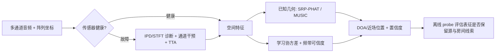

# 五篇的共同问题：空间线索在何处丢失，怎样保留或恢复？

| 工作 | 直接任务与阵列 | 主路线 | 最有价值的实证 | 结论边界 |
|---|---|---|---|---|
| [[NeuralMUSIC 2026]] | 宽带 DOA，机器人阵列，单/多/未知源数 | 学 $\hat R_x$，解析 MUSIC + 频率注意力 + masked-channel SSCL | 多数据集 MA​​AE；AV16.3 未知源数 13.51° | 各数据集/先验不一致，SLoClas/AFPILD 对传统法允许最优角偏移 |
| [[SFF 多说话人 DOA 2026]] | 双麦、远场、多静态说话人 | SFF 包络/相位相关与 PHAT，时间直方图聚合 | 0 dB SiSEC 中 SFF-PHAT 五类噪声 MAE 都最低 | 1 m 双麦、人数已知、静态源；并非任意阵列结论 |
| [[SARL 空间表征探测基准 2026]] | 冻结 encoder 的空间因素可解码性 | 受控合成 RIR + linear probe + embedding sensitivity | FOA/SSL 较能保留 source/room 因素，room 普遍更难 | 不是 DOA 系统；合成单源、mean pooling、线性 probe |
| [[软体藤蔓机器人分布式声定位 2026]] | 已知位置但形状变化的五麦软体阵列；近/远场 | 几何 SRP-PHAT 扫描 | 圆阵远场 1.1°、近场 0.034 m；三麦生长时误差大降 | 白噪声、实验室二维；必须知道实时麦位，非“无校准” |
| [[容错 SSL 诊断引导测试时自适应 2026]] | 四麦远场 2D DOA，单麦硬件故障 | STFT+IPD 故障诊断、指定干预、硬伪标签 TTA | 平均 MAE 21.99→9.91°；真实拔线 29.20→16.57° | 预定义故障；少于三有效麦的几何信息不能靠 TTA 恢复 |

## 可合并的设计原则

1. **保留显式空间结构是一种可归纳的设计倾向。** NeuralMUSIC 保留 $R_x$--EVD--伪谱，SFF 保留跨通道 phase/envelope，藤蔓机器人以已测几何计算 TDOA，容错系统以 IPD 识别复制故障；SARL 的 probe 也显示 richer spatial input（尤其 FOA）通常更可解码。这是跨论文的综合观察，不表示五篇作者提出同一统一立场。
2. **不要把“鲁棒”当一个单一维度。** SFF 的证据是低 SNR/混响双麦多说话人；NeuralMUSIC 是任务/房间/阵列 transfer；藤蔓工作是 geometry、source range、安装位置；TTA 是传感器故障；SARL 是 embedding 诊断。五组数字的指标和数据不相同，不能跨行宣称 SOTA。
3. **几何和可用通道数是不可绕过的下限。** 非共线/近圆 aperture 解决藤蔓阵的前后/距离歧义；TTA 仍要求至少三有效麦；NeuralMUSIC 的跨阵列迁移优于对照但仍随大 mismatch 变弱。学习应被用来估计、加权或恢复可靠空间线索，而不是替代不存在的观测。

## 面向实际机器人系统的组合路线

这是一种由五篇工作的互补性导出的工程方案，不是其中任何论文已经端到端验证的系统。实践上应先记录阵列坐标与失效状态，再按任务选择近/远场 delay model；为每个部署域分别报告角误差、检测率、运行时和故障恢复曲线。
